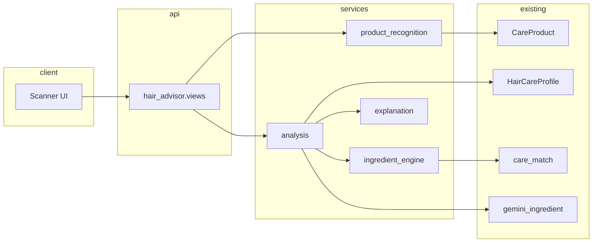

# AI Hair Care Advisor — Architecture

## Stack

| Layer | Technology |
|-------|------------|
| API | Django 5 + DRF (`hair_advisor` app) |
| Catalog | Existing `ai.CareProduct`, `HairCareProfile` |
| Scoring | `ai.services.care_match` (deterministic) |
| OCR | `ai.services.gemini_ingredient` |
| Barcode | `ai.services.product_barcode_lookup` + `hair_advisor.services.barcode` (checksum) |
| Cache / queue | Redis (existing Try-On queue unchanged) |
| Mobile / Web | React Native + Vite React (existing) |

## Module boundaries

## Data model

- **HairProduct** — normalized advisor record; optional 1:1 `care_product`.
- **HairScan** — UUID workflow with explicit `status` state machine.
- **HairAnalysis** — versioned JSON (`schema_version` 1.0), recommendations `POTENTIAL_MATCH | CAUTION | INSUFFICIENT_DATA`.
- **HairRoutine** / **HairRoutineItem** — links to `CareProduct` + user saves.
- **ProductComparison** — persisted compare sessions.
- **Ingredient** / **ProductIngredient** / **IngredientEvidence** — normalized INCI (populated incrementally).

Legacy **`IngredientScanEntry`** still written on completed analysis for backward compatibility.

## Processing rules

1. Barcode → checksum validation → internal DB → external adapters.
2. Missing INCI → `INGREDIENTS_REQUIRED` or OCR → `NEEDS_CONFIRMATION`.
3. User confirms ingredients → deterministic analysis → optional text explanation.
4. LLM does **not** invent ingredients; Gemini only used for OCR path (existing pipeline).

## Concurrency

Hair Advisor analysis runs synchronously in API workers today. Try-On continues to use `ai.services.tryon_queue` with separate Redis keys—no shared queue channel.

## Navigation

Morph shell center action = **Scan** (`MorphIngredient` / `/ai-style/care/ingredient`). MySaloon shell center remains Morf AI entry.