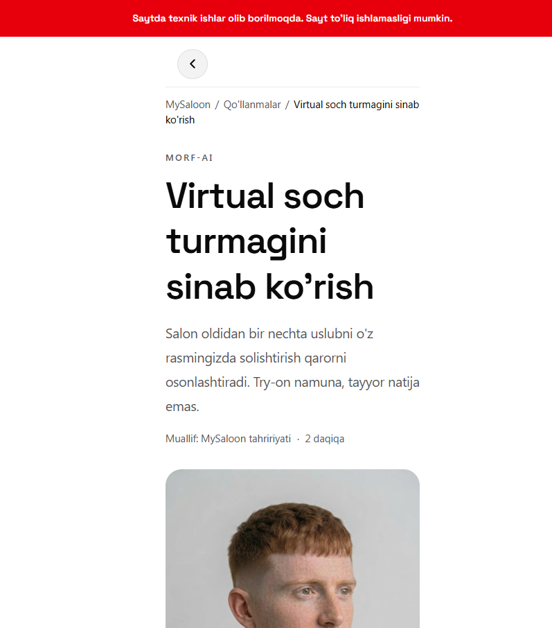
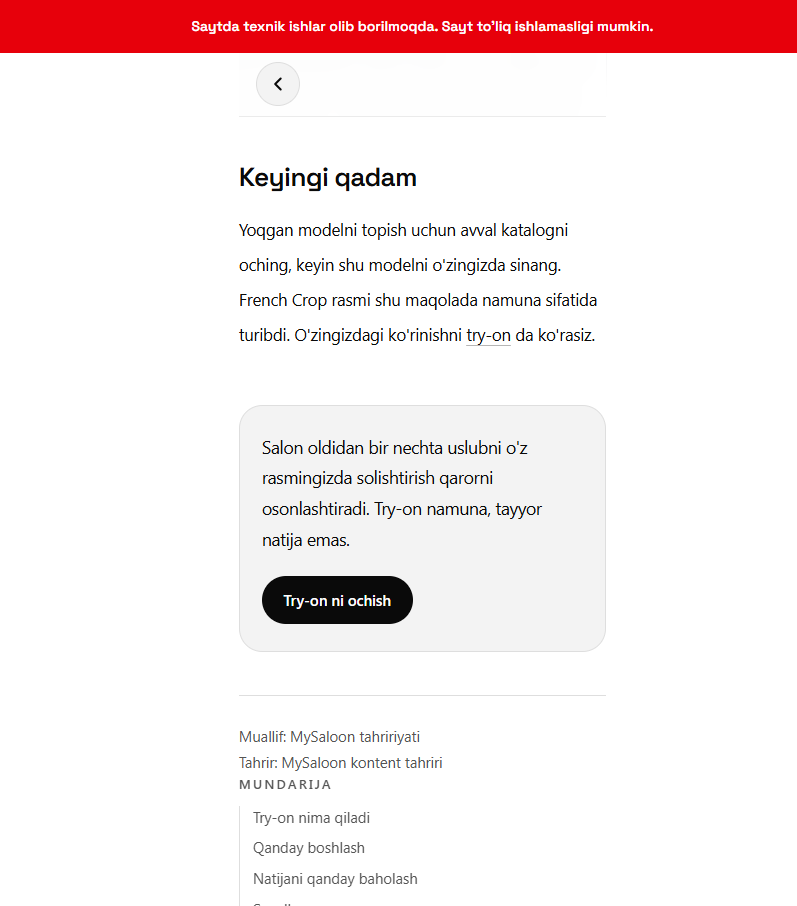
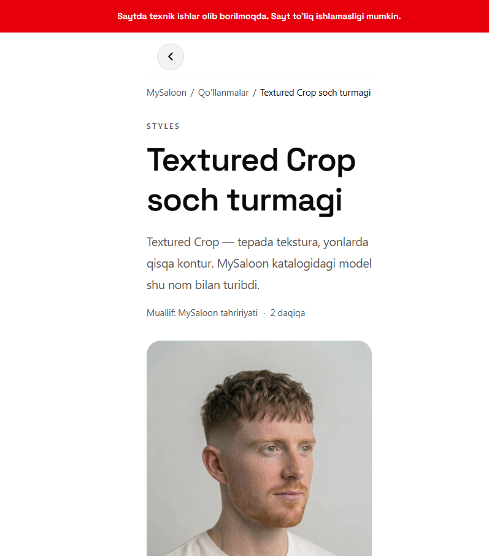
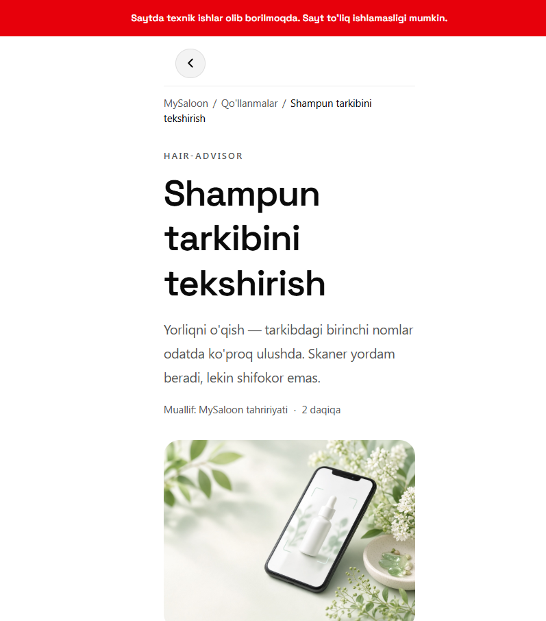
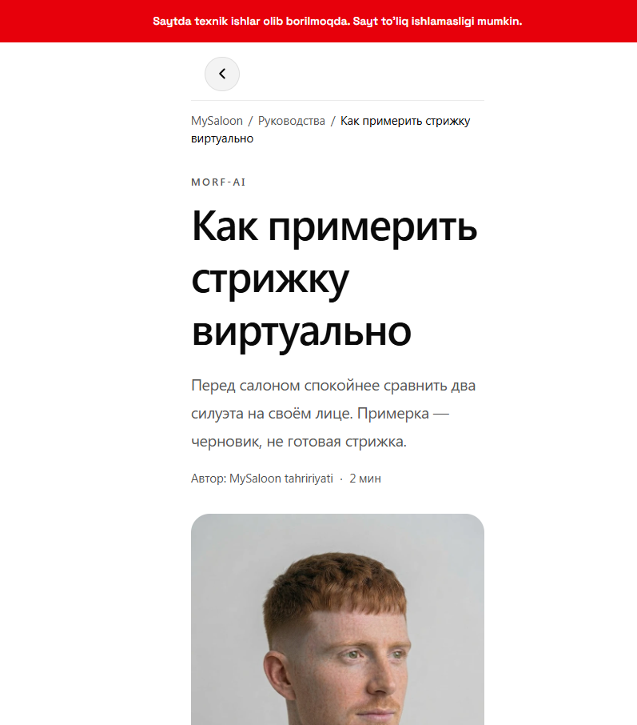
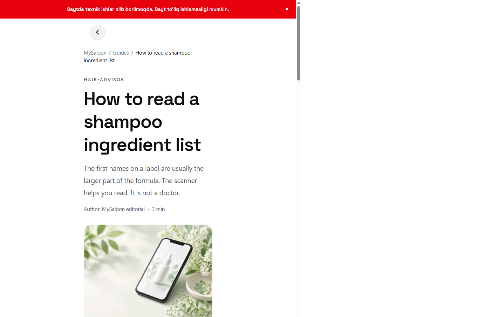
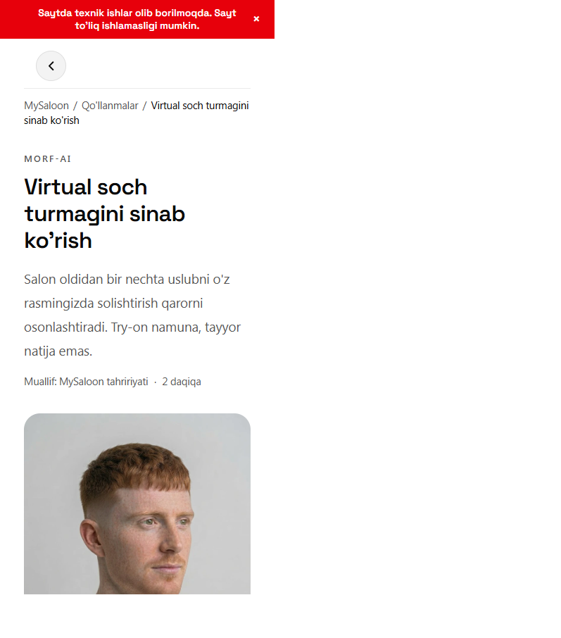
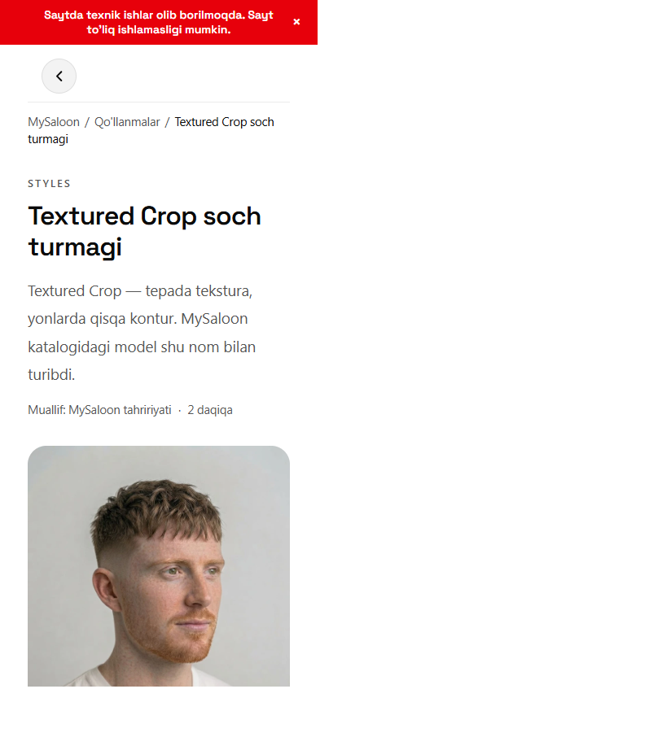
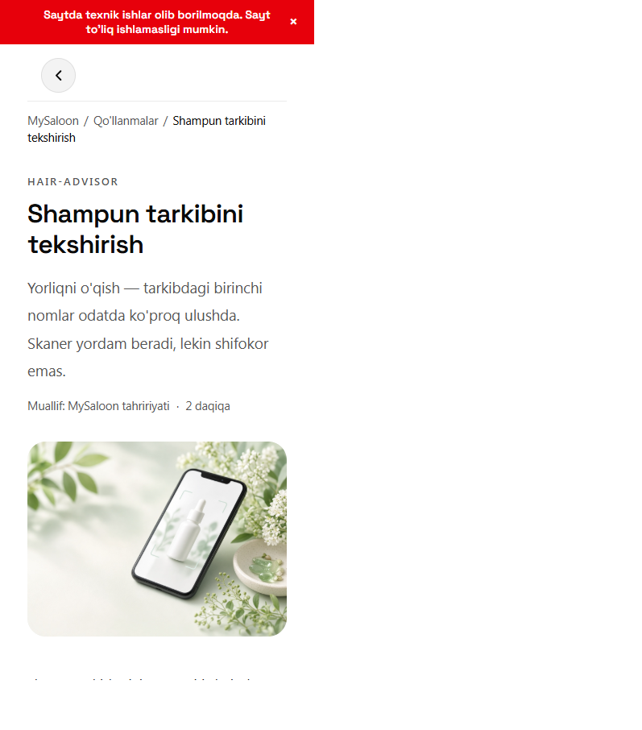

# SEO Phase 1 — content, article UI, and publication review

Date: 2026-11-27  
Branch: `feat/seo-phase1-content` (from `origin/main`)  
Status: **draft. Not published. Not deployed. Scanner V2 branch was not modified.**

The three Phase 1 guides were rewritten in Uzbek, Russian, and English. They stay `status=draft` with `published_at` empty. The public Content API returns 404 for them. A local preview needs `CONTENT_DRAFT_PREVIEW=true` and `?preview=1`. Do not set that flag in production.

Full copy lives in `backend/content_seo/phase1_articles.py`. Slugs are unchanged.

## Publication status

| Slug | UZ | RU | EN | Public API | Sitemap / hreflang |
| --- | --- | --- | --- | --- | --- |
| `virtual-soch-turmagini-sinab-korish` | draft | draft | draft | 404 | omitted |
| `textured-crop-soch-turmagi` | draft | draft | draft | 404 | omitted |
| `shampun-tarkibini-tekshirish` | draft | draft | draft | 404 | omitted |

hreflang and `sitemap-blog` include a locale only after that locale is published (`status=published` and `published_at <= now`). Draft preview pages send `noindex, nofollow` and no hreflang.

## Article metadata

Author and reviewer are the editorial desk, not a clinician.

| Locale | Author | Reviewer |
| --- | --- | --- |
| uz | MySaloon tahririyati | MySaloon kontent tahriri |
| ru | Редакция MySaloon | Редактор контента MySaloon |
| en | MySaloon editorial | MySaloon content editor |

### 1. Virtual try-on

- Slug: `virtual-soch-turmagini-sinab-korish`
- Category: `morf-ai`
- UZ title / H1: Virtual soch turmagini sinab ko'rish
- SEO title: Virtual soch turmagini sinab ko'rish | Morf AI
- Meta: Selfie va katalogdagi uslub bilan yangi soch turmagini oldindan ko'ring. Morf AI try-on namuna beradi, sartarosh natijasini kafolatlamaydi.
- RU H1: Как примерить стрижку виртуально
- RU SEO title: Виртуальная примерка стрижки | Morf AI
- EN H1: Try a haircut on your own photo
- EN SEO title: Virtual haircut try-on | Morf AI
- Cover: `https://mysaloon.uz/hairstyles/men/personas/irland/french-crop.webp` (768×1024 WebP)
- ALT (UZ): French Crop katalog gapiga mos, natija emasligi aytiladi
- CTA: `/ai-style` — event `tryon_cta_click`
- Related styles: `men-french-crop`, `men-textured-crop`
- Related articles: the other two slugs
- Sources: none. The piece does not make an external factual claim.
- URLs: `/guides/virtual-soch-turmagini-sinab-korish`, `/ru/guides/...`, `/en/guides/...`

### 2. Textured Crop

- Slug: `textured-crop-soch-turmagi`
- Category: `styles`
- UZ H1: Textured Crop soch turmagi
- SEO title: Textured Crop — qisqa teksturali erkaklar turmagi
- Meta: Textured Crop: tepa hajmli, yonlar qisqa. Katalog modeli, parvarish va MySaloon try-on yo'li.
- RU SEO title: Textured Crop — короткая текстурная стрижка
- EN SEO title: Textured Crop — a short textured men's cut
- Cover: `https://mysaloon.uz/hairstyles/men/personas/irland/textured-crop.webp` (768×1024 WebP)
- Catalog check: `GET https://api.mysaloon.uz/api/v1/hairstyles/men-textured-crop/` returns id `men-textured-crop`, slug `textured-crop`, audience men, hair length short.
- CTA: `/explore/men-textured-crop/try` — event `tryon_cta_click`
- Source: `https://mysaloon.uz/explore/men-textured-crop` (first-party catalog page)

### 3. Shampoo label

- Slug: `shampun-tarkibini-tekshirish`
- Category: `hair-advisor`
- UZ H1: Shampun tarkibini tekshirish
- SEO title: Shampun tarkibini tekshirish | Hair Advisor
- Meta: Shampun yorlig'idagi ingredientlar ro'yxatini qanday o'qish mumkin. Hair Advisor skaneri nomlarni tushuntiradi, tashxis qo'ymaydi.
- RU SEO title: Состав шампуня — как читать этикетку | Hair Advisor
- EN H1: How to read a shampoo ingredient list
- EN SEO title: How to check a shampoo formula | Hair Advisor
- Cover: `https://mysaloon.uz/care/care-card-scan.jpg` (1152×864). This is the existing care-card illustration of a phone and a dropper bottle. It is not a real scan result. ALT text says so. The file was not re-encoded; the catalog crops are already WebP.
- CTA: `/ai-style/care/ingredient` — event `scan_cta_click`
- Sources: Regulation (EC) No 1223/2009 Article 19 (`https://eur-lex.europa.eu/legal-content/EN/TXT/?uri=CELEX:32009R1223`) and CosIng (`https://ec.europa.eu/growth/tools-databases/cosing/`). Titles are written in the article locale. No invented ingredients, medical effects, or guaranteed results.
- Scanner V2 gallery, offline mode, and history are not described as verified production features.

## Feature routes that were checked before linking

These routes exist in the user app today:

| Destination | Role |
| --- | --- |
| `/ai-style` | AI try-on product |
| `/morf-ai/try-on` | Try-on marketing page. Locale copy exists at `/ru/morf-ai/try-on` and `/en/morf-ai/try-on` |
| `/explore/men-textured-crop` | Catalog card |
| `/explore/men-textured-crop/try` | That model's try-on |
| `/explore/men-french-crop` and `/explore/men-french-crop/try` | French Crop card used as the try-on example |
| `/ai-style/care/ingredient` | Hair Advisor ingredient scanner |
| `/morf-ai/ingredient-scanner` | Scanner marketing page, with `/ru` and `/en` copies |

`/ai-style` and `/explore/...` do not have `/$locale` route files. Article links keep those paths. Links to `/guides/...` and `/morf-ai/...` are prefixed for Russian and English because those route files exist. A rendered Russian try-on page included `/ru/guides/textured-crop-soch-turmagi`, `/ru/morf-ai/try-on`, `/ai-style`, and `/explore/men-textured-crop`.

## Article UI

`GuideArticlePage` in `apps/user/src/components/guides/GuideArticleView.tsx` uses the existing black/white tokens, `--foreground`, `--muted-foreground`, `--border`, `--surface`, and Space Grotesk. The reading column is `max-w-[40rem]`. The table of contents sits beside the text only from the `lg` breakpoint. Below that, the text stays a normal column.

The page includes breadcrumb, category, one H1 (the article title), excerpt, author, reading time, hero image with width/height/alt, TOC, contextual CTA, related hairstyle cards, related articles, sources, and reviewer. The page header on the article does not add a second H1.

Reading time is word count / 180, minimum 1 minute. Numbered steps in the markdown render as paragraphs.

## Screenshots

Local draft preview at `http://127.0.0.1:3000`, with the dev client adding `preview=1`. The red maintenance banner is the existing site banner.

Desktop:

Phone width 390:

## SEO head

Production HTML injection (`injectSeoIntoHtml`) writes the article title, description, canonical, Open Graph image, `noindex` while unpublished, hreflang only for published locales, and Article plus breadcrumb JSON-LD.

The Vite dev shell does not run that injector. After the article data loads, `syncGuideDocumentHead` writes the same fields into the live document so a browser and a JS crawler see one set of tags. Checked on the English shampoo draft after hydration:

- title: `How to check a shampoo formula | Hair Advisor`
- description: the English meta description
- robots: `noindex, nofollow`
- canonical: `https://mysaloon.uz/en/guides/shampun-tarkibini-tekshirish`
- og:type: `article`
- og:image: `https://mysaloon.uz/care/care-card-scan.jpg`
- hreflang: none

Guide index canonicals are locale-specific (`/guides`, `/ru/guides`, `/en/guides`) with hreflang between those three index URLs, because the index routes exist.

## Image sitemap and title mismatch

Live production on 2026-11-27:

- `https://mysaloon.uz/sitemap-styles.xml`: 62 `<url>`, 62 `<image:loc>`
- `https://mysaloon.uz/sitemap-images.xml`: 62 `<url>`, 62 `<image:loc>`

The earlier “124 image:loc for 62 style URLs” count is not present in the live files. `dedupeSitemapImages` collapses identical image locations inside one URL and keeps distinct images. Covered by `apps/user/src/seo/seo.test.ts`.

Production HTML for `/explore/men-textured-crop` was the same for a normal browser user agent and Googlebot: title and og:title `Textured Crop — soch uslubi | Morf AI | mysaloon.uz`, prerender H1 `Textured Crop`. No crawler-specific body was added. The explore document title now uses one helper, `exploreDocumentTitle`, in both the HTML injector and the route head, so a later client render does not replace the injected title with the generic `Uslub — mysaloon.uz`. That alignment is in this branch. Production keeps the currently deployed frontend until this branch is released.

## Analytics

Existing allow-listed events cover the funnel:

1. `organic_landing_view` on the guides index
2. `blog_article_view` when an article loads (`dedupeKey` `guide-{locale}-{slug}`)
3. `tryon_cta_click` or `scan_cta_click` on the article CTA (`dedupeKey` `cta-{locale}-{slug}`)
4. `ai_tryon_opened` and `barcode_scan_started` on the existing feature screens
5. `registration_started` when the phone check intent is register, without the phone number
6. existing registration and payment events

`organicReferrerProps` sets `google_surface` to `images` when the referrer contains `tbm=isch` or `imgres`, otherwise `search`, and only when the host contains `google.`. A visit with no referrer is not labeled as Google. `cleanProps` drops keys matching password, token, otp, secret, or card. Dedupe is in-memory for the page session.

## Tests

- Vitest: `article-markdown.test.ts` 4, `seo.test.ts` 9, `image-seo.test.ts` 3. 16 passed.
- Django: `content_seo.tests` 4 passed on a temporary SQLite file. Public detail of a draft is 404. Preview without the setting is 404. Preview with the setting returns the draft and an empty `published_locales`. A published locale is listed; a draft translation is not.
- ESLint on the touched guide and SEO files: clean.
- Lighthouse is not a project dependency and was not installed. Laboratory Core Web Vitals were not measured. Field CrUX / Search Console data was not available in this session. Do not treat the missing lab run as a field score.

## Content quality

The Uzbek articles explain a real next step: how to open try-on, how to read a Textured Crop preview, and how an ingredient list is ordered. They say the preview is a sample and the scanner is not a diagnosis. Russian and English versions follow the same limits and were written as articles, not word-for-word machine output. Catalog facts match the live Textured Crop record. No unsupported percentages were added.

## How to publish later

Do this only after the owner approves the copy.

1. Deploy this branch through the normal user-app and VPS backend release. Do not merge `feat/scanner-v2-release-candidate`.
2. Leave `CONTENT_DRAFT_PREVIEW` unset in production.
3. In Django admin, for each approved locale row, set `status` to `published` and `published_at` to the release time. Publish UZ, RU, and EN separately if a translation is not approved.
4. Confirm `GET /api/v1/content/articles/{slug}/?locale=uz` returns 200 and the list endpoint includes the row.
5. Confirm the HTML response has the article canonical, the cover as `og:image`, hreflang only for the locales just published, and `sitemap-blog.xml` lists only those URLs.
6. Open `/guides/{slug}`, `/ru/guides/{slug}`, and `/en/guides/{slug}` and click the CTA through to the feature.

Until that approval, these nine rows must stay drafts.

## Remaining blockers

- Owner approval before any status change.
- This branch is not deployed. Production still serves the previous frontend and does not contain these drafts until the VPS migration `content_seo.0004` and `0005` run.
- Lighthouse and field Core Web Vitals were not measured here.
- `/ai-style` and `/explore` have no locale-prefixed routes, so those CTAs leave the `/ru` or `/en` prefix. The product UI language still follows the app locale.
- The care-card cover remains JPEG. Re-encoding it was avoided so the existing illustration file stayed intact.
- The local API used for preview is SQLite with draft preview enabled. It is not the production database.
